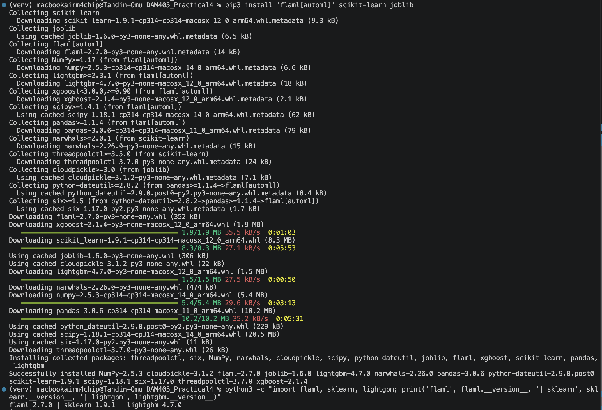
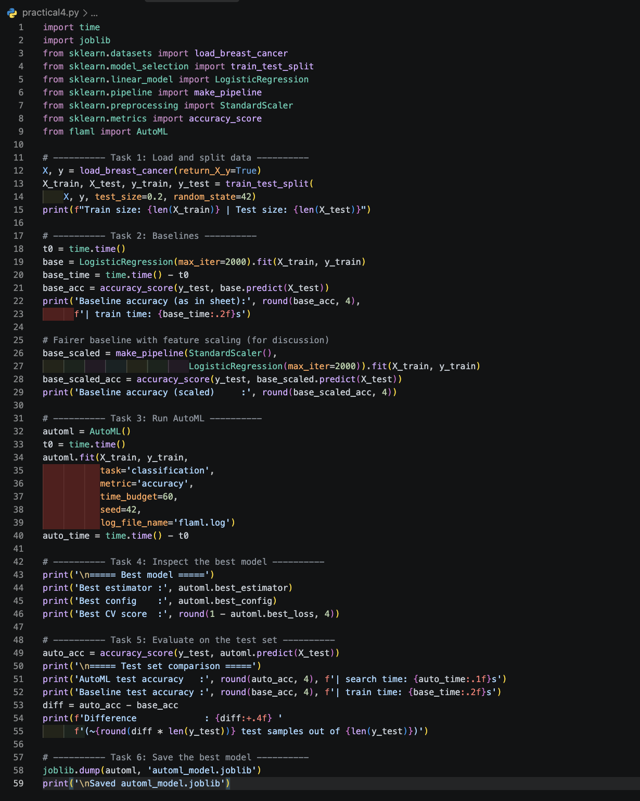
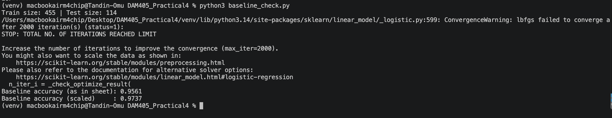
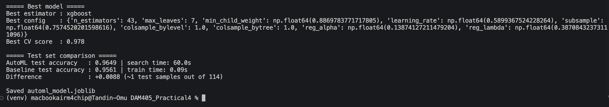
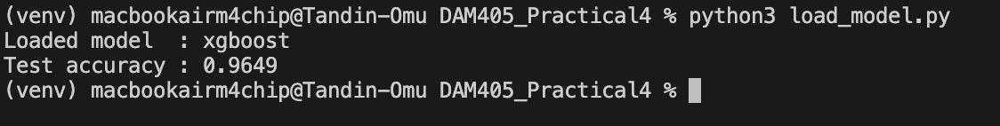
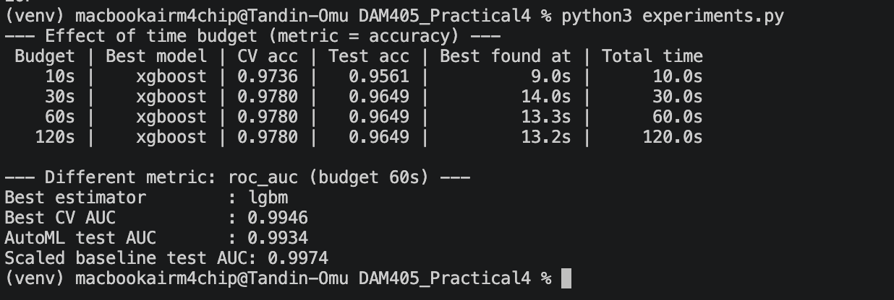

# Practical 4: Automated Training and Tuning with FLAML

## Overview

This practical uses **FLAML**, an open-source AutoML library, to automatically train and tune a classifier on the scikit-learn breast cancer dataset. The AutoML result is compared with a logistic regression baseline, the best model is inspected, and the final model is saved for later use.

**Key finding:** FLAML found a strong model (XGBoost, 0.9649 test accuracy), but a properly scaled logistic regression achieved 0.9737 in much less time. AutoML is useful, but it should always be compared against a well-built baseline.

## Learning Outcomes

- Use an open-source AutoML tool to train and tune a model.
- Compare an AutoML result against a simple baseline model.
- Inspect the best model, its hyperparameters and its score.
- Save the resulting model for later use.

## Environment

| Item | Version |
| --- | --- |
| Machine | MacBook Air (Apple M4) |
| Python | 3.14.7 |
| FLAML | 2.7.0 |
| scikit-learn | 1.9.1 |
| LightGBM | 4.7.0 |
| Editor | VS Code |

## Project Structure

```
DAM405_Practical4/
├── practical4.py          # Main script (Tasks 1–6)
├── load_model.py          # Reloads and tests the saved model
├── experiments.py         # Optional time budget and metric experiments
├── automl_model.joblib    # Saved AutoML model
├── requirements.txt       # Exact package versions
├── screenshots/           # Figures used in this README
└── README.md
```

## Setup

```bash
mkdir -p ~/Desktop/DAM405_Practical4
cd ~/Desktop/DAM405_Practical4
python3 -m venv venv
source venv/bin/activate
pip3 install "flaml[automl]" scikit-learn joblib
pip freeze > requirements.txt
```

To reproduce the environment from the saved file:

```bash
pip3 install -r requirements.txt
```



*Figure 1: Package installation and version check.*

## Usage

```bash
python3 practical4.py     # Run Tasks 1–6
python3 load_model.py     # Reload and test the saved model
python3 experiments.py    # Run the optional experiments
```



*Figure 2: The script practical4.py in VS Code.*

## Method

### Task 1: Load and split the data

The breast cancer dataset (569 samples, 30 features, binary label) was loaded and split 80/20 into 455 training and 114 test samples, using `random_state=42`.

### Task 2: Build a baseline

A logistic regression model (`max_iter=2000`) was trained as the reference model. It produced a convergence warning, meaning training did not finish properly, so a second version with `StandardScaler` was also trained for a fair comparison.

| Baseline | Test accuracy |
| --- | --- |
| Unscaled (as in the practical sheet) | 0.9561 |
| Scaled | 0.9737 |



*Figure 3: Unscaled and scaled baseline accuracies, with the convergence warning.*

### Task 3: Run AutoML

FLAML was run with the following settings:

```python
automl.fit(X_train, y_train,
           task='classification',
           metric='accuracy',
           time_budget=60,
           seed=42)
```

The seed makes the results reproducible. Within 60 seconds, FLAML evaluated over 700 configurations of XGBoost, LightGBM, random forest, logistic regression and SGD.

### Task 4: Inspect the best model

| Item | Result |
| --- | --- |
| Best estimator | XGBoost |
| Best configuration | 43 trees, 7 leaves, learning rate ≈ 0.59, subsample ≈ 0.76 |
| Best cross-validation score | 0.978 |
| Time to find best model | ≈ 15.7 seconds |

### Task 5: Evaluate on the test set

The AutoML model and both baselines were evaluated on the same test set.



*Figure 4: Best model, its hyperparameters (Task 4) and the test set comparison (Task 5).*

### Task 6: Save the model

The model was saved with joblib as `automl_model.joblib` and reloaded in `load_model.py`. The reloaded model gave the same result (XGBoost, 0.9649), confirming it was saved correctly.



*Figure 5: Reloading the saved model.*

## Results

| Model | Test accuracy | Correct (out of 114) | Training time |
| --- | --- | --- | --- |
| Baseline (scaled) | **0.9737** | 111 | Under 1 s |
| AutoML (XGBoost) | 0.9649 | 110 | 60 s |
| Baseline (unscaled, as in sheet) | 0.9561 | 109 | 0.09 s |

AutoML outperformed the unscaled baseline by one test sample, but the scaled baseline outperformed AutoML by one test sample.

## Optional Experiment: Time Budget and Metric

FLAML was run again with time budgets of 10, 30, 60 and 120 seconds, and once with `roc_auc` as the metric.

| Time budget | Best model | CV accuracy | Test accuracy | Best found at |
| --- | --- | --- | --- | --- |
| 10 s | XGBoost | 0.9736 | 0.9561 | 9.0 s |
| 30 s | XGBoost | 0.9780 | 0.9649 | 14.0 s |
| 60 s | XGBoost | 0.9780 | 0.9649 | 13.3 s |
| 120 s | XGBoost | 0.9780 | 0.9649 | 13.2 s |

- **Time budget:** The 10-second run ended early and scored lower. From 30 seconds onwards, the same model was found at about 14 seconds, so extra time only increased cost.
- **ROC-AUC:** FLAML selected LightGBM, with a test AUC of 0.9934. The scaled baseline achieved a higher test AUC of 0.9974.



*Figure 6: Time budget and ROC-AUC experiment results.*

## Reflection Questions

**1. Did AutoML beat your baseline? By how much, and was the extra compute time worth it?**

AutoML outperformed the baseline from the practical sheet by 0.0088 (0.9649 compared with 0.9561), which is one additional correct prediction out of 114. However, that baseline did not converge. When scaled, the baseline achieved 0.9737 and outperformed AutoML. Since AutoML required 60 seconds compared with under one second for the baseline, the extra compute time was not justified for this dataset.

**2. What did AutoML automate for you, and which decisions still required a human?**

AutoML automated algorithm selection, hyperparameter tuning and cross-validation, evaluating over 700 configurations. Human decisions were still required for the dataset, data split, metric and time budget, for building a fair baseline, for identifying the need for scaling, and for judging whether the final model was acceptable.

**3. How does increasing the time budget affect the result and the cost?**

Cost increases directly with the time budget, but the result does not keep improving. At 10 seconds the search ended early and scored lower. From 30 seconds onwards the same model was found at about 14 seconds, so longer budgets added cost with no improvement. A larger or more complex dataset would be more likely to benefit from a longer budget.


## Conclusion

FLAML found a strong model (XGBoost, 0.9649 test accuracy) without manual tuning, and the model was saved and reloaded successfully. However, on this small and clean dataset, a properly scaled logistic regression performed as well or better in much less time. AutoML is a useful tool, but its results should always be compared against a well-built baseline.